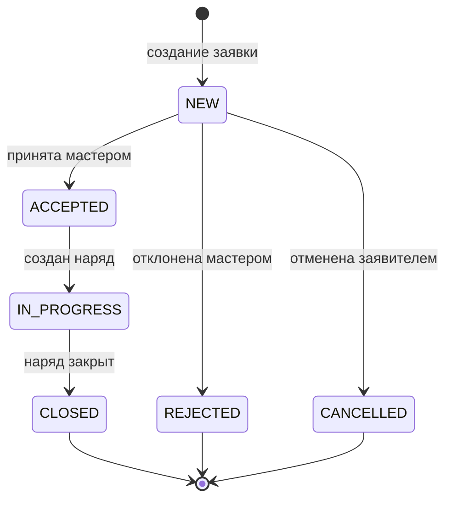
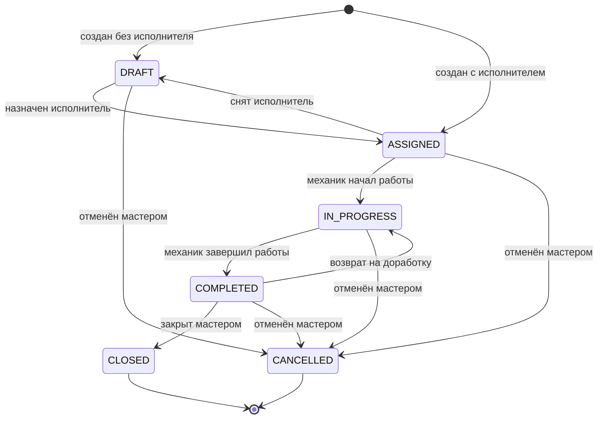
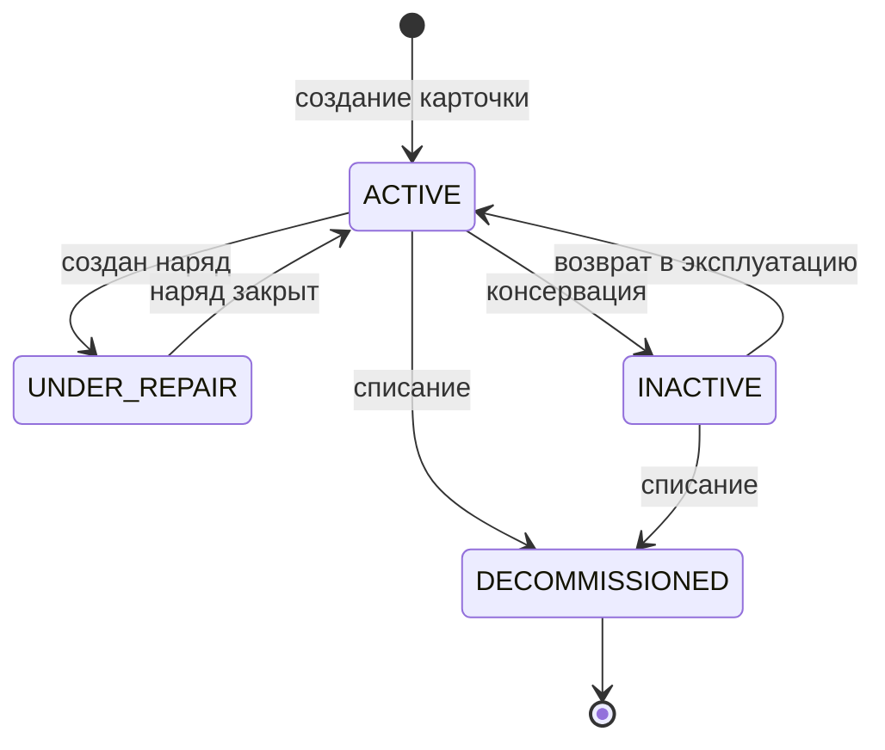

# Жизненные циклы сущностей

## Назначение документа

Документ описывает жизненные циклы ключевых сущностей EAM-системы: заявки, наряда и актива. Для каждой сущности определены статусы, допустимые переходы, условия переходов и роли, которые могут их выполнять.

Документ устраняет неоднозначность в статусах между функциональными требованиями (`02-functional-requirements.md`), вариантами использования (`04-use-cases.md`) и будущей ER-диаграммой (`06-er-diagram.md`).

## Обозначения

| Символ | Значение |
|---|---|
| → | Допустимый переход |
| ✗ | Запрещённый переход |
| Конечный | Статус, из которого нет выхода |

---

## 1. Заявка (Request)

### 1.1. Статусы

| Код | Отображение | Тип | Описание |
|---|---|---|---|
| `NEW` | Новая | Начальный | Заявка создана, ожидает рассмотрения мастером |
| `ACCEPTED` | Принята | Промежуточный | Мастер принял заявку, начинается создание наряда |
| `IN_PROGRESS` | В работе | Промежуточный | По заявке создан наряд, работы выполняются |
| `CLOSED` | Закрыта | Конечный | Наряд по заявке закрыт, работы выполнены |
| `REJECTED` | Отклонена | Конечный | Мастер отклонил заявку с указанием причины |
| `CANCELLED` | Отменена | Конечный | Заявитель отменил заявку до её принятия |

### 1.2. Начальный и конечные статусы

- **Начальный статус:** `NEW` (устанавливается автоматически при создании заявки).
- **Конечные статусы:** `CLOSED`, `REJECTED`, `CANCELLED` (из них нет выхода).

### 1.3. Таблица переходов

| Из статуса | В статус | Кто выполняет | Условие | Связанный UC / FR |
|---|---|---|---|---|
| — | `NEW` | Заявитель | Создание заявки | UC-02, FR-REQUEST-001 |
| `NEW` | `ACCEPTED` | Мастер | Мастер принимает заявку в работу | UC-03, FR-REQUEST-007 |
| `NEW` | `REJECTED` | Мастер | Мастер отклоняет заявку с указанием причины | UC-03, FR-REQUEST-008 |
| `NEW` | `CANCELLED` | Заявитель | Заявитель отменяет заявку до её принятия | UC-02, FR-REQUEST-004 |
| `ACCEPTED` | `IN_PROGRESS` | Мастер | Мастер создаёт наряд на основе заявки | UC-04, FR-WORKORDER-001 |
| `IN_PROGRESS` | `CLOSED` | Мастер | Мастер закрывает наряд по заявке | UC-06, FR-WORKORDER-010 |

### 1.4. Запрещённые переходы

| Из статуса | В статус | Почему запрещено |
|---|---|---|
| `CLOSED` | любой | Конечный статус |
| `REJECTED` | любой | Конечный статус |
| `CANCELLED` | любой | Конечный статус |
| `NEW` | `IN_PROGRESS` | Нельзя начать работы, не приняв заявку |
| `NEW` | `CLOSED` | Нельзя закрыть заявку, не выполнив работы |
| `ACCEPTED` | `CLOSED` | Нельзя закрыть заявку без создания наряда |
| `ACCEPTED` | `CANCELLED` | Заявитель может отменить только до принятия |
| `IN_PROGRESS` | `REJECTED` | Нельзя отклонить заявку, по которой уже идут работы |
| `IN_PROGRESS` | `CANCELLED` | Заявитель не может отменить заявку, по которой уже идут работы |

### 1.5. Диаграмма состояний 

### 1.6. Ограничения

- Заявка не может быть удалена — только переведена в конечный статус.
- Изменение статуса заявки фиксируется в журнале аудита (FR-AUDIT-001).
- Заявитель видит только свои заявки (FR-REQUEST-011).
- Заявитель не может вручную менять статус заявки (FR-REQUEST-012).

---

## 2. Наряд (WorkOrder)

### 2.1. Статусы

| Код | Отображение | Тип | Описание |
|---|---|---|---|
| `DRAFT` | Черновик | Начальный (опционально) | Наряд создан, но исполнитель не назначен |
| `ASSIGNED` | Назначен | Промежуточный | Исполнитель назначен, работы ещё не начаты |
| `IN_PROGRESS` | В работе | Промежуточный | Механик начал выполнение |
| `COMPLETED` | Выполнен | Промежуточный | Механик отметил завершение работ |
| `CLOSED` | Закрыт | Конечный | Мастер проверил и закрыл наряд |
| `CANCELLED` | Отменён | Конечный | Наряд отменён мастером с указанием причины |

### 2.2. Начальный и конечные статусы

- **Начальные статусы:** `DRAFT` (если исполнитель не назначен) или `ASSIGNED` (если исполнитель назначен сразу).
- **Конечные статусы:** `CLOSED`, `CANCELLED`.

### 2.3. Таблица переходов

| Из статуса | В статус | Кто выполняет | Условие | Связанный UC / FR |
|---|---|---|---|---|
| — | `DRAFT` | Мастер | Создание наряда без исполнителя | UC-04 (А5.1) |
| — | `ASSIGNED` | Мастер | Создание наряда с назначением исполнителя | UC-04, FR-WORKORDER-003 |
| `DRAFT` | `ASSIGNED` | Мастер | Назначение исполнителя | UC-04, FR-WORKORDER-003 |
| `ASSIGNED` | `IN_PROGRESS` | Механик | Механик начинает выполнение | UC-05, FR-WORKORDER-014 |
| `ASSIGNED` | `CANCELLED` | Мастер | Отмена наряда до начала работ | UC-04, FR-WORKORDER-009 |
| `ASSIGNED` | `DRAFT` | Мастер | Снятие исполнителя (возврат в черновик) | UC-04, FR-WORKORDER-007 |
| `IN_PROGRESS` | `COMPLETED` | Механик | Механик отмечает завершение | UC-05, FR-WORKORDER-019 |
| `IN_PROGRESS` | `CANCELLED` | Мастер | Отмена наряда во время работ | FR-WORKORDER-009 |
| `COMPLETED` | `CLOSED` | Мастер | Мастер проверяет и закрывает наряд | UC-06, FR-WORKORDER-010 |
| `COMPLETED` | `IN_PROGRESS` | Мастер | Возврат на доработку | UC-06 (А3.1) |
| `COMPLETED` | `CANCELLED` | Мастер | Отмена наряда после выполнения (при обнаружении проблем) | FR-WORKORDER-009 |

### 2.4. Запрещённые переходы

| Из статуса | В статус | Почему запрещено |
|---|---|---|
| `CLOSED` | любой | Конечный статус |
| `CANCELLED` | любой | Конечный статус |
| `DRAFT` | `IN_PROGRESS` | Нельзя начать работы без назначенного исполнителя |
| `DRAFT` | `COMPLETED` | Нельзя завершить работы, не начав их |
| `ASSIGNED` | `COMPLETED` | Нельзя завершить работы, не начав их |
| `ASSIGNED` | `CLOSED` | Нельзя закрыть наряд, не выполнив работы |

### 2.5. Диаграмма состояний 

### 2.6. Ограничения

- Наряд не может быть удалён — только переведён в конечный статус.
- Изменение статуса наряда фиксируется в журнале аудита (FR-AUDIT-001).
- Механик не может изменять наряды, назначенные другим исполнителям (FR-WORKORDER-020).
- Механик не может создавать наряды (FR-WORKORDER-021).
- При переводе наряда в `CLOSED` данные фиксируются в истории оборудования (UC-06).
- При переводе наряда в `COMPLETED` фактически использованные запчасти списываются со склада (UC-05).

---

## 3. Актив (Asset)

### 3.1. Статусы

| Код | Отображение | Тип | Описание |
|---|---|---|---|
| `ACTIVE` | В работе | Начальный | Оборудование введено в эксплуатацию и работает |
| `UNDER_REPAIR` | На ремонте | Промежуточный | По оборудованию выполняется ремонт (есть активный наряд) |
| `INACTIVE` | Неактивен | Промежуточный | Оборудование временно не используется (простой, консервация) |
| `DECOMMISSIONED` | Списано | Конечный | Оборудование выведено из эксплуатации |

### 3.2. Начальный и конечные статусы

- **Начальный статус:** `ACTIVE` (устанавливается при создании карточки актива).
- **Конечный статус:** `DECOMMISSIONED`.

### 3.3. Таблица переходов

| Из статуса | В статус | Кто выполняет | Условие | Связанный UC / FR |
|---|---|---|---|---|
| — | `ACTIVE` | Мастер / Администратор | Создание карточки актива | UC-07, FR-ASSET-001 |
| `ACTIVE` | `UNDER_REPAIR` | Система (автоматически) | Создан наряд по этому активу | FR-ASSET-003 |
| `UNDER_REPAIR` | `ACTIVE` | Система (автоматически) | Наряд закрыт | FR-ASSET-003 |
| `ACTIVE` | `INACTIVE` | Мастер / Администратор | Оборудование временно не используется | FR-ASSET-003 |
| `INACTIVE` | `ACTIVE` | Мастер / Администратор | Оборудование возвращено в эксплуатацию | FR-ASSET-003 |
| `ACTIVE` / `INACTIVE` | `DECOMMISSIONED` | Администратор | Списание оборудования (при отсутствии активных заявок/нарядов) | FR-ASSET-008 |

### 3.4. Запрещённые переходы

| Из статуса | В статус | Почему запрещено |
|---|---|---|
| `DECOMMISSIONED` | любой | Конечный статус |
| `UNDER_REPAIR` | `DECOMMISSIONED` | Нельзя списать оборудование, по которому идут работы |
| `UNDER_REPAIR` | `INACTIVE` | Нельзя перевести в неактив, пока идёт ремонт |
| любой | `DECOMMISSIONED` | Нельзя списать при наличии активных заявок или нарядов |

### 3.5. Диаграмма состояний 

### 3.6. Ограничения

- Актив не может быть удалён — только переведён в `DECOMMISSIONED` (FR-ASSET-008).
- Нельзя списать актив при наличии связанных заявок или нарядов (FR-ASSET-008).
- Изменение статуса актива фиксируется в истории оборудования (FR-ASSET-005).
- Изменение статуса актива фиксируется в журнале аудита (FR-AUDIT-001).

---

## 4. Прочие сущности

### 4.1. Пользователь (User)

| Код | Отображение | Тип | Описание |
|---|---|---|---|
| `ACTIVE` | Активен | Начальный | Учётная запись активна, пользователь может входить |
| `BLOCKED` | Заблокирован | Промежуточный | Учётная запись заблокирована администратором |

**Переходы:**
- `ACTIVE` → `BLOCKED` — Администратор блокирует учётную запись (FR-USER-005).
- `BLOCKED` → `ACTIVE` — Администратор разблокирует учётную запись (FR-USER-006).

**Ограничения:**
- Пользователь не может удалить свою учётную запись (FR-USER-010).
- Пользователь не может изменить свою роль (FR-USER-011).

### 4.2. Запчасть (SparePart)

| Код | Отображение | Тип | Описание |
|---|---|---|---|
| `ACTIVE` | Активна | Начальный | Запчасть доступна для использования |
| `ARCHIVED` | Архивирована | Конечный | Запчасть больше не используется |

**Переходы:**
- `ACTIVE` → `ARCHIVED` — Администратор архивирует запчасть (при отсутствии остатков).

**Ограничения:**
- Запчасть не удаляется физически — только архивируется.

---

## 5. Связь между заявкой и нарядом

Жизненные циклы заявки и наряда связаны:

1. **Создание наряда:** когда мастер создаёт наряд на основе заявки (UC-04), заявка переходит из `ACCEPTED` в `IN_PROGRESS`.
2. **Закрытие наряда:** когда мастер закрывает наряд (UC-06), заявка переходит из `IN_PROGRESS` в `CLOSED`.
3. **Отмена наряда:** если мастер отменяет наряд, заявка остаётся в `IN_PROGRESS` (работы не выполнены, но заявка не закрыта). Мастер может создать новый наряд или отклонить заявку.

## 6. Связь между нарядом и активом

1. **Создание наряда:** когда создаётся наряд по активу, актив переходит из `ACTIVE` в `UNDER_REPAIR` (если ещё не в этом статусе).
2. **Закрытие наряда:** когда наряд закрывается, актив возвращается в `ACTIVE` (если по нему нет других активных нарядов).
3. **Отмена наряда:** если наряд отменяется, актив возвращается в `ACTIVE` (если по нему нет других активных нарядов).

## 7. Сводная таблица статусов

### Заявка

| Код | Отображение | Тип |
|---|---|---|
| `NEW` | Новая | Начальный |
| `ACCEPTED` | Принята | Промежуточный |
| `IN_PROGRESS` | В работе | Промежуточный |
| `CLOSED` | Закрыта | Конечный |
| `REJECTED` | Отклонена | Конечный |
| `CANCELLED` | Отменена | Конечный |

### Наряд

| Код | Отображение | Тип |
|---|---|---|
| `DRAFT` | Черновик | Начальный (опционально) |
| `ASSIGNED` | Назначен | Промежуточный |
| `IN_PROGRESS` | В работе | Промежуточный |
| `COMPLETED` | Выполнен | Промежуточный |
| `CLOSED` | Закрыт | Конечный |
| `CANCELLED` | Отменён | Конечный |

### Актив

| Код | Отображение | Тип |
|---|---|---|
| `ACTIVE` | В работе | Начальный |
| `UNDER_REPAIR` | На ремонте | Промежуточный |
| `INACTIVE` | Неактивен | Промежуточный |
| `DECOMMISSIONED` | Списано | Конечный |